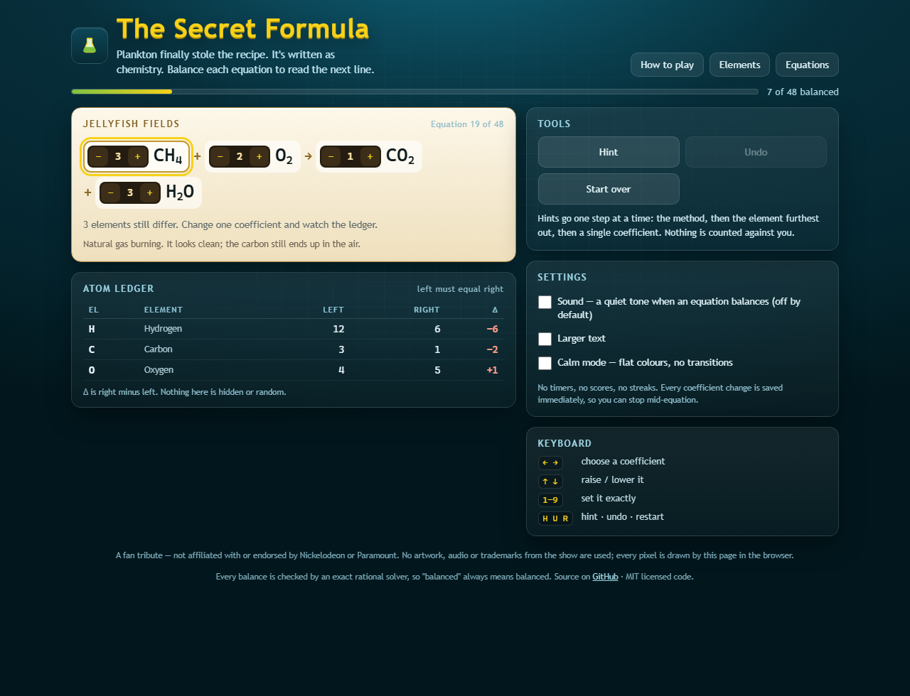

# 🧪 The Secret Formula

**A chemistry puzzle dressed as a SpongeBob episode: balance real chemical equations with an exact rational solver standing behind every check. One HTML file, zero dependencies, no timer.**

[**▶ Play it live**](https://nwfella.github.io/secret-formula/) · [Source](https://github.com/nwfella/secret-formula)



Plankton has finally stolen the Krabby Patty recipe. It is written as chemistry. Each
line is a real reaction missing its coefficients, and the next line only becomes
readable when the atoms on both sides agree.

---

## How to play

| | |
|---|---|
| **Goal** | Give every compound a coefficient so each element has the same atom count on both sides |
| **Change a coefficient** | Click `−` / `+`, or focus a compound and use `↑` `↓` |
| **Move between compounds** | `←` `→`, or click one |
| **Set an exact value** | Type `1`–`9` with a compound selected |
| **Hint** | `H` — three tiers: method, then the worst element, then one exact coefficient |
| **Undo / restart** | `U` / `R` |
| **No timer, no score** | An equation is solved the moment it balances; progress saves after every change |

There is no confirm button, no life counter, no streak and no leaderboard. If you balance
an equation with multiples of the smallest numbers the game accepts it and says so,
because chemists write the smallest whole numbers by convention.

---

## What is actually real

Every one of the 48 equations is a real reaction with real products, spanning five
chapters: synthesis, decomposition, combustion, single/double replacement and redox.

**The solver is the interesting part.** An equation is a linear system: each element is a
row, each species a column, reactants positive and products negative. Balancing *is*
finding that matrix's null space. The page reduces the matrix to row-echelon form with
exact `BigInt` fractions, so:

- a balance is a **proved fact**, not a string match against a stored answer;
- every level has **exactly one** valid ratio (checked at build time);
- nothing is stored that could drift from the chemistry.

Molar masses are computed from standard atomic weights, and the mass readout under each
solved equation shows the conserved total on both sides.

---

## Built for one particular player

This was designed for an autistic 22-year-old who likes systems, exact rules and real
detail. That shaped every decision, and it makes the game better for everyone:

| Requirement | How it is implemented |
|---|---|
| **Predictability** | One fixed rule set. No random events, no hidden state, no surprises. |
| **No time pressure** | No timer anywhere in the codebase — asserted by the gate. |
| **No punishing failure** | An unbalanced equation just shows you where it is off. Nothing is lost. |
| **Explicit rules** | A written rules screen, a per-equation reaction note, and a live ledger of every element. |
| **Recoverability** | Unlimited undo, restart to the seeded start, save after every change. |
| **Sensory control** | Sound off by default with one toggle; calm mode; `prefers-reduced-motion` honoured. |
| **Motor access** | Whole game playable from the keyboard; 32 px touch targets on phones. |
| **Adult substance** | Real redox chemistry, real molar masses — not a counting game for children. |
| **No social pressure** | Local progress only. No accounts, no scores, no comparisons. |

---

## Verification

Two gates, 1008 assertions, both green before every deploy:

```bash
npm run verify          # 915 assertions — the chemistry, in Node, no browser
npm run verify:browser  #  93 assertions — a real Chrome over CDP
```

The Node gate lifts the shipped `CORE` block out of `index.html` and proves, for all 48
levels: a unique positive-integer solution exists, the solution is in lowest terms, the
ledger balances at it, mass is conserved at it, the seeded start is *not* already solved,
nudging any single coefficient breaks the balance, and the hints never dump the answer.
It also checks the formula parser against nested groups (`Ca3(PO4)2`, `(NH4)2SO4`,
`Fe2(SO4)3`), molar masses against textbook values, and that the core touches no DOM.

The browser gate boots the page in headless Chrome, solves **all 48 equations through the
real DOM**, then checks undo, the hint ladder, reset, persistence across a reload, all
three dialogs, reduced-motion behaviour, the `[hidden]` contract, and zero overflow at
1500/1024/768/390/320 px. It fails on any console error.

---

## Run it

```bash
git clone https://github.com/nwfella/secret-formula
open index.html          # that's it — no build, no server, no install
```

---

## Layout

```
index.html               the whole game: markup, CSS, chemistry core, DOM layer
scripts/verify_app.js    tier 1 — Node gate over the shipped core
scripts/browser_check.js tier 2 — real-browser gate over what actually rendered
scripts/cdp.js           minimal Chrome DevTools Protocol driver (no npm)
screenshots/             captures from the browser gate
SPEC.md                  the design spec this was built against
```

---

## Licence and tribute

Code is MIT licensed.

A fan tribute — **not affiliated with, endorsed by, or connected to Nickelodeon or
Paramount**. No artwork, audio, characters or trademarks from the show appear anywhere:
every pixel is drawn by this page in the browser, and every sound is synthesised. The
SpongeBob references are text-only jokes in the reaction notes.
